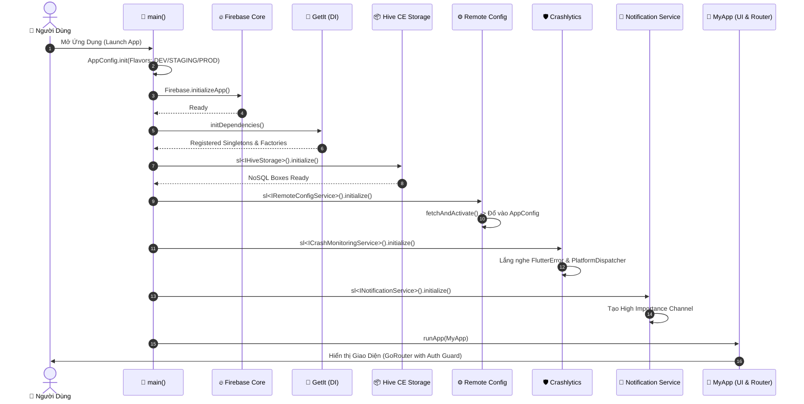
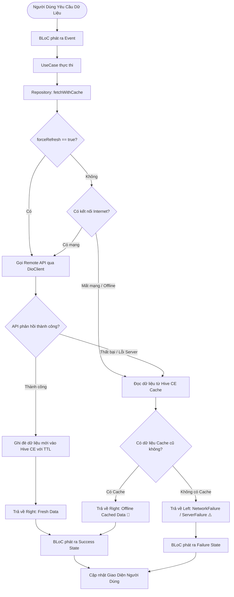

# 🚀 Flutter Enterprise Base Project

> **Kiến trúc Flutter chuẩn Enterprise** được tối ưu hóa cho hiệu năng cao, mở rộng quy mô lớn (Clean Architecture + BLoC 9 + GoRouter + Hive CE + Firebase Suite).

<p align="center">
  
</p>

---

## 📑 Mục Lục
1. [Tổng Quan Dự Án](#-tổng-quan-dự-án)
2. [Sơ Đồ Kiến Trúc Động (Execution & Architecture Diagrams)](#-sơ-đồ-kiến-trúc-động-execution--architecture-diagrams)
   * [2.1. Sơ đồ Luồng Khởi Chạy Ứng Dụng (Bootstrap Sequence)](#21-sơ-đồ-luồng-khởi-chạy-ứng-dụng-bootstrap-sequence)
   * [2.2. Sơ đồ Xử Lý Dữ Liệu & Offline Cache Flow](#22-sơ-đồ-xử-lý-dữ-liệu--offline-cache-flow)
   * [2.3. Sơ đồ Luồng Xác Thực & Auth Guard Routing](#23-sơ-đồ-luồng-xác-thực--auth-guard-routing)
3. [Cấu Trúc Thư Mục Chuẩn](#-cấu-trúc-thư-mục-chuẩn)
4. [Các Tính Năng & Công Nghệ Cốt Lõi](#-các-tính-năng--công-nghệ-cốt-lõi)
5. [Tài Liệu Hướng Dẫn Kỹ Thuật (Docs)](#-tài-liệu-hướng-dẫn-kỹ-thuật-docs)
6. [Bắt Đầu Nhanh (Quick Start)](#-bắt-đầu-nhanh-quick-start)

---

## 🎯 Tổng Quan Dự Án

**`base_project`** là bộ khung khởi đầu (Starter Template / Enterprise Blueprint) hoàn chỉnh dành cho các dự án Flutter quy mô từ vừa đến lớn. Dự án được thiết kế tuân thủ nghiêm ngặt nguyên lý **SOLID**, **Clean Architecture** và tách biệt hoàn toàn giữa **Business Logic**, **Data & Cache Layer**, **Network** và **Giao diện người dùng (UI)**.

### ✨ Điểm nổi bật:
* 🛡️ **Clean Architecture 3 Lớp**: Domain (Entities & UseCases) $\rightarrow$ Data (Models, DataSources & Repositories) $\rightarrow$ Presentation (BLoC & UI).
* ⚡ **BLoC 9 State Management**: Quản lý trạng thái hướng sự kiện (Event-Driven), dễ viết Unit Test và dự đoán luồng dữ liệu.
* 🌐 **Network Layer Chuyên Nghiệp**: Dio Client tích hợp Token Refresh tự động, Queued Interceptor, Logger và Exception/Failure mapping chuẩn hóa.
* 📦 **Offline Mode & Caching Siêu Tốc**: Quản lý cache NoSQL với `hive_ce` kèm cơ chế TTL (Time-To-Live) và chiến lược *Stale-While-Revalidate*.
* 🔥 **Firebase Suite Sẵn Sàng Cho Production**: Firebase Core, Remote Config (cấu hình động đổ thẳng vào AppConfig), Crashlytics (bắt lỗi UI & Async toàn cầu), Analytics và Push Notification (Foreground, Background, Cold Start).
* 🎨 **Design System & Widget Kit Đa Dạng**: 15 nhóm widget dùng chung (Buttons 7 styles, SuperTooltip, PinCode OTP, Slidable Tile, Masonry Grid, Percent Indicators...) kết hợp ScreenUtil co giãn responsive.

---

## 🔄 Sơ Đồ Kiến Trúc Động (Execution & Architecture Diagrams)

### 2.1. Sơ đồ Luồng Khởi Chạy Ứng Dụng (Bootstrap Sequence)

Sơ đồ tuần tự thể hiện toàn bộ các bước khởi tạo nền tảng từ khi mở app trong [main.dart](file:///d:/base_project/lib/main.dart):



---

### 2.2. Sơ đồ Xử Lý Dữ Liệu & Offline Cache Flow

Sơ đồ quy trình lấy dữ liệu kết hợp giữa **Remote API (Dio)** và **Local Storage (Hive CE)** hỗ trợ chế độ ngoại tuyến (**Offline First / Stale-While-Revalidate**):



---

### 2.3. Sơ đồ Luồng Xác Thực & Auth Guard Routing

Cơ chế bảo vệ tuyến đường (Protected Routes) của `GoRouter` kết hợp `AuthBloc`:

```mermaid
stateDiagram-v2
    [*] --> Initial: Khởi động Ứng Dụng
    Initial --> CheckingSession: AuthCheckRequested
    
    CheckingSession --> Authenticated: Tìm thấy AccessToken trong SecureStorage
    CheckingSession --> Unauthenticated: Không có Token hoặc Token hết hạn
    
    state "Trạng Thái: Đã Đăng Nhập (Authenticated)" as Authenticated {
        [*] --> HomePage: Tự động điều hướng vào /home (Gallery UI Kit)
        HomePage --> LogoutAction: Bấm nút Đăng xuất
        LogoutAction --> Unauthenticated: AuthLogoutRequested (Xóa Token)
    }

    state "Trạng Thái: Chưa Đăng Nhập (Unauthenticated)" as Unauthenticated {
        [*] --> LoginPage: Chuyển hướng vào /login
        LoginPage --> SubmitLogin: Nhập Email / Mật khẩu
        SubmitLogin --> Authenticated: Đăng nhập thành công -> Lưu Token
    }
```

---

## 📂 Cấu Trúc Thư Mục Chuẩn

```
lib/
├── app/                           # Cấu hình cấp ứng dụng
│   ├── constants/                 # Hằng số toàn dự án (AppName, DesignSize, Locales...)
│   ├── router/                    # GoRouter với Auth Guard & Transitions
│   ├── theme/                     # Design Tokens (Colors, Typography, Dimensions, Theme)
│   └── app.dart                   # Root Widget (ScreenUtilInit + Localization + MaterialApp)
│
├── core/                          # Hạ tầng lõi độc lập
│   ├── config/                    # Flavor & Môi trường (DEV, STAGING, PROD, Remote Config Data)
│   ├── di/                        # Service Locator GetIt (initDependencies)
│   ├── network/                   # DioClient, ApiEndpoints, AuthInterceptor, NetworkInfo
│   │   └── errors/                # Exceptions & Failures
│   ├── services/                  # Firebase Services (Crashlytics, RemoteConfig, Analytics, FCM)
│   ├── storage/                   # Hive CE Cache Storage, BaseCachePolicy, Local & SecureStorage
│   ├── utils/                     # Tiện ích bổ trợ (Formatters, Logger, Debouncer, Validators)
│   └── core.dart                  # Top-level Barrel Export
│
├── features/                      # Các Module nghiệp vụ theo Clean Architecture
│   └── auth/                      # Ví dụ Module Xác thực (Login / Logout)
│       ├── data/                  # Models, DataSources (Remote & Local), Repositories Impl
│       ├── domain/                # Entities, Repositories Contract, UseCases
│       └── presentation/          # BLoC (Events, States), Pages, Widgets
│
├── shared/                        # Tài nguyên và Widget dùng chung toàn App
│   ├── extensions/                # Context Extensions, String & Number Extensions
│   └── widgets/                   # Thư viện UI Kit phong phú
│       ├── buttons/               # AppButton (7 styles, 3 sizes, Pill, Loading)
│       ├── grids/                 # AppGridView, AppMasonryGridView
│       ├── images/                # AppAvatar, AppCachedImage, MediaPickerSheet
│       ├── inputs/                # AppTextField, AppOtpField, AppDatePicker, AppSwitch...
│       ├── interactive/           # AppPercentIndicator, AppAccordion, AppRatingBar...
│       ├── lists/                 # AppListTile, AppSlidableTile, AppRefreshWrapper
│       ├── tooltips/              # AppTooltip (SuperTooltip mũi tên chỉ hướng)
│       └── typography/            # AppText (tích hợp AutoSizeText), AppRichText
│
└── main.dart                      # Điểm khởi động ứng dụng chuẩn hóa
```

---

## 🚀 Các Tính Năng & Công Nghệ Cốt Lõi

| Nhóm | Công nghệ / Thư viện | Vai trò |
| :--- | :--- | :--- |
| **State Management** | `flutter_bloc: ^9.0.0`, `bloc: ^9.0.0` | Quản lý trạng thái BLoC phân tách rõ ràng Event/State |
| **Dependency Injection** | `get_it: ^8.0.3` | Service Locator tiêm phụ thuộc lười biếng (Lazy Singleton) |
| **Routing & Auth Guard** | `go_router: ^14.8.1` | Khai báo Route tập trung, tự động bảo vệ màn hình (Auth Guard) |
| **Mạng & API** | `dio: ^5.8.0`, `pretty_dio_logger` | Giao tiếp HTTP/RESTful, tự động refresh token khi 401 |
| **Cache & Offline** | `hive_ce: ^2.0.0`, `hive_ce_flutter` | CSDL NoSQL cục bộ tốc độ cao, hỗ trợ TTL & Offline First |
| **Bảo mật Token** | `flutter_secure_storage: ^9.2.4` | Lưu JWT Token mã hóa trên Keystore (Android) / Keychain (iOS) |
| **Firebase Suite** | `firebase_core`, `crashlytics`, `remote_config`, `analytics` | Giám sát lỗi, lấy cấu hình từ xa, theo dõi hành vi người dùng |
| **UI & Layout** | `flutter_screenutil: ^5.9.3`, `gap: ^3.0.1` | Tự động co giãn theo tỉ lệ thiết kế Figma (375x812) |
| **Interactive UI** | `super_tooltip`, `flutter_slidable`, `pin_code_fields`, `flutter_staggered_grid_view`, `percent_indicator`, `auto_size_text` | Bộ Widget trực quan, hiện đại, mượt mà |
| **Đa ngôn ngữ** | `easy_localization: ^3.0.7` | Hỗ trợ chuyển đổi nhanh Tiếng Việt / Tiếng Anh |

---

## 📚 Tài Liệu Hướng Dẫn Kỹ Thuật (Docs)

Hệ thống tài liệu kỹ thuật chi tiết đã được biên soạn đầy đủ trong thư mục `docs/`:

1. 📖 [**01_FIREBASE_SETUP_GUIDE.md**](file:///d:/base_project/docs/01_FIREBASE_SETUP_GUIDE.md): Hướng dẫn từng bước thiết lập Firebase cho Android, iOS, Web, cấu hình `google-services.json`, Crashlytics, Remote Config & Cloud Messaging.
2. 💻 [**02_CLI_COMMANDS_AND_FLAVORS.md**](file:///d:/base_project/docs/02_CLI_COMMANDS_AND_FLAVORS.md): Bảng tổng hợp câu lệnh Flutter hay dùng, hướng dẫn cấu hình và chạy đa môi trường (DEV / STAGING / PROD).
3. 📦 [**03_BUILD_SIGNING_AND_DEPLOYMENT.md**](file:///d:/base_project/docs/03_BUILD_SIGNING_AND_DEPLOYMENT.md): Hướng dẫn cấu hình Keystore ký số ứng dụng (Android/iOS), quy trình Build APK/AAB/IPA và thiết lập CI/CD tự động.
4. 🏗️ [**04_TECHNICAL_ARCHITECTURE_AND_GUIDELINES.md**](file:///d:/base_project/docs/04_TECHNICAL_ARCHITECTURE_AND_GUIDELINES.md): Quy chuẩn viết code Clean Architecture, mẫu thêm mới một Feature chuẩn, quy chuẩn Network & Cache Policy.

---

## ⚡ Bắt Đầu Nhanh (Quick Start)

### 1. Cài đặt Dependencies
```bash
flutter pub get
```

### 2. Chạy Kiểm Thử (Unit / Widget / Integration Tests)
```bash
flutter test
```

### 3. Chạy Ứng Dụng (Môi trường Dev)
```bash
flutter run --dart-define=ENVIRONMENT=DEV
```
